# مخطط ERD وقرارات التطبيع

الحالة: In Review

<aside>
🧩

مخطط ERD لنظام **Hasobjy System** مُصمَّم بـ Claude Design: 13 لوحة (نظرة عامة، مخططان للعلاقات، لوحة تفصيلية لكل وحدة A–I بحقولها وأنواعها وقيودها، ولوحة التطبيع). اللوحة خاصة بحسابك ويُفتح رابطها من قائمة Artifacts في Claude، ويمكن مشاركتها من زر المشاركة. هذه الصفحة نسخة مختصرة قابلة للقراءة داخل Notion.

</aside>

[قصص المستخدم (User Stories)](%D9%82%D8%B5%D8%B5%20%D8%A7%D9%84%D9%85%D8%B3%D8%AA%D8%AE%D8%AF%D9%85%20(User%20Stories)%203f8921ef52a981aabc61d1179a3a9e4b.md)

## الأرقام

- **76** جدولاً، **630** حقلاً، **141** علاقة مفتاح أجنبي.
- المستوى: **3NF/BCNF**.
- 9 وحدات (A–I).

## الوحدات

| الوحدة | المحتوى | عدد الجداول |
| --- | --- | --- |
| A | الحسابات والأجهزة والأمان (users, devices, auth_sessions, security_events…) | 9 |
| B | الأكاديمي والتقويم (departments, terms, student_term_enrollments, department_subjects, exam_schedules) | 6 |
| C | المحتوى: مواد وكورسات، دروس، فيديو، PDF | 15 |
| D | التمارين وتصحيح Gemini | 8 |
| E | نشاط الطالب والأوفلاين | 7 |
| F | المنتجات والدفع والقسائم والصلاحيات | 13 |
| G | العلامات والكشوف | 5 |
| H | الإعلانات والإشعارات والدعم | 8 |
| I | النظام والتدقيق (files, audit, flags, settings, versions) | 5 |

## مخطط العلاقات الرئيسية

```mermaid
erDiagram
  users ||--o| student_profiles : has
  users ||--o{ devices : owns
  users ||--o{ student_term_enrollments : enrolls
  users ||--o{ payments : pays
  users ||--o{ grades : receives
  users ||--o{ exercise_attempts : submits
  users ||--o{ lesson_watch_progress : watches
  users ||--o{ support_conversations : opens
  devices ||--o{ auth_sessions : has
  devices ||--o{ usage_sessions : logs
  devices ||--o{ offline_video_downloads : stores
  academic_years ||--o{ terms : contains
  terms ||--o{ student_term_enrollments : in
  departments ||--o{ student_term_enrollments : in
  departments ||--o{ department_subjects : plans
  subjects ||--o{ department_subjects : in
  learning_containers ||--o| subjects : subtype
  learning_containers ||--o| courses : subtype
  learning_containers ||--o{ lessons : has
  course_categories ||--o{ courses : groups
  lessons ||--o| video_assets : has
  video_assets ||--o{ video_renditions : has
  lessons ||--o{ exercises : has
  exercises ||--o{ mcq_options : has
  exercises ||--o{ exercise_attempts : receives
  exercise_attempts ||--o| code_submissions : has
  code_submissions ||--o{ ai_evaluations : graded_by
  pdf_documents ||--o{ pdf_versions : versions
  products ||--o{ product_prices : priced
  products ||--o| product_subject_term : subtype
  products ||--o| product_semester_bundle : subtype
  products ||--o| product_course : subtype
  products ||--o{ payments : bought
  payments ||--o| entitlements : grants
  payments ||--o| payment_shamcash : via
  payments ||--o| payment_manual_receipts : via
  voucher_batches ||--o{ vouchers : contains
  vouchers ||--o| payments : redeemed_by
  subjects ||--o{ grades : graded
  terms ||--o{ grades : in
  grade_import_batches ||--o{ grade_import_rows : stages
  grade_import_rows ||--o| grades : source
  notifications ||--o{ notification_recipients : delivered_to
  support_conversations ||--o{ support_messages : has
  files ||--o{ pdf_versions : stores
```

## قرارات التطبيع الأساسية

- **1NF:** لا قيم متعددة في حقل واحد: مخرجات الكورس في `course_outcomes`، والمرفقات عبر جداول ربط مع `files`.
- **2NF:** وزن العملي/النظري خاصية للمادة، وجداول المفاتيح المركبة تعتمد أعمدتها على المفتاح كاملاً.
- **3NF:** المستخدم لا يُخزَّن حيث يمكن اشتقاقه (من الجهاز أو الدفعة)، والمنتج في القسيمة يأتي من الدفعة، والمجموع عمود مولَّد، والمعدل التراكمي View.
- **BCNF:** قيود UNIQUE تعكس كل اعتماد وظيفي، وجهاز نشط واحد لكل مستخدم بفهرس جزئي.
- **أب وفروع:** `learning_containers` ← `subjects`/`courses`، و`products` ← ثلاثة أنواع، بمفتاح مركّب `(id, kind)` مع CHECK على النوع.
- **سجلات تاريخية مقصودة:** `security_events`, `video_license_requests`, `ai_evaluations`, `admin_audit_logs`.

## Views وTriggers المطلوبة

- Views: إكمال الدرس، نسب التقدم، الوقت الأسبوعي، المعدل التراكمي، الوصول الفعّال.
- Triggers: خيار صحيح واحد على الأقل لكل سؤال MCQ، اتساق تفاصيل الدفع مع طريقته، واتساق جهاز الصلاحية مع مستخدم الدفعة.

## قرارات مفتوحة

- مدة صلاحية الكورس: دائمة أم محدّدة؟ (`product_course.access_duration_days`، NULL = دائم)
- عملة الأسعار: ليرة أم دولار أم الاثنان؟