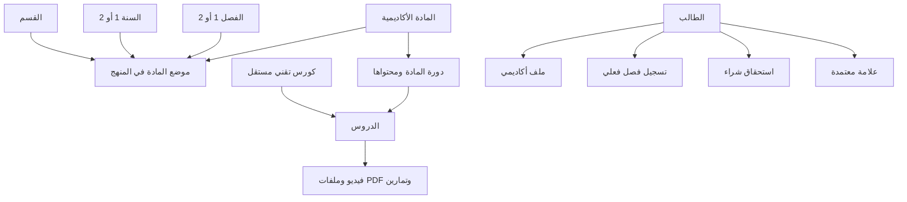
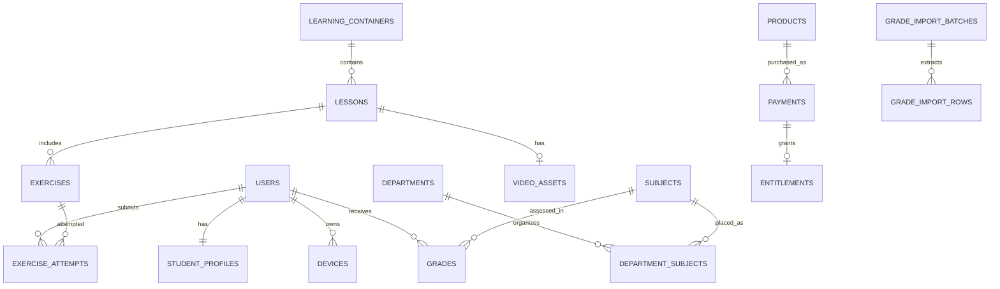
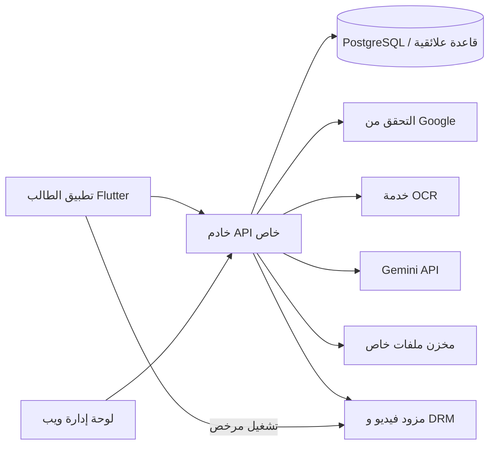

# الدليل الشامل لنظام حاسوبجي — CIT Zone

**تاريخ إعداد الدليل:** 14 أكتوبر 2026  
**الغرض:** مرجع واحد لفهم المنتج، رحلة الطالب والإدارة، بنية البيانات، المعمارية المقترحة، الحماية، الفجوات، وحالة التطبيق الحالية.  
**قاعدة الاعتماد:** اعتمدت صفحات Hasobjy في Notion كما وجّه صاحب المنتج، حتى إذا كانت حالة الصفحة `In Review` أو غيرها. حالة المراجعة في Notion لا تلغي اعتماد محتواها.

> **اقرأ هذا أولاً:** هذا المستودع يحتوي معاينات Flutter وتجهيزات أولية، وخططاً تفصيلية للتنفيذ. لا يحتوي حالياً خادم إنتاج أو قاعدة بيانات CIT Zone عاملة أو لوحة إدارة ويب أو DRM مدمجاً. سكيما Notion وثيقة تصميم؛ الأرقام وعبارة اختبار PostgreSQL منقولة من Notion ولم يُشغّل ملف SQL في هذه المراجعة.

## فهرس الدليل

1. [ملخص النظام](#1-ملخص-النظام)
2. [المنتج والنطاق](#2-المنتج-والنطاق)
3. [رحلات الاستخدام](#3-رحلات-الاستخدام)
4. [النموذج الأكاديمي والعلامات](#4-النموذج-الأكاديمي-والعلامات)
5. [تصميم قاعدة البيانات](#5-تصميم-قاعدة-البيانات)
6. [ما بين ERD وSQL والتنفيذ](#6-ما-بين-erd-وsql-والتنفيذ)
7. [معمارية النظام المقترحة](#7-معمارية-النظام-المقترحة)
8. [الأمن والوسائط دون اتصال](#8-الأمن-والوسائط-دون-اتصال)
9. [حالة المشروع المحلي](#9-حالة-المشروع-المحلي)
10. [القرارات المفتوحة ومخاطرها](#10-القرارات-المفتوحة-ومخاطرها)
11. [ترتيب التنفيذ المقترح](#11-ترتيب-التنفيذ-المقترح)
12. [مصطلحات النظام](#12-مصطلحات-النظام)
13. [المصادر وحدود التحقق](#13-المصادر-وحدود-التحقق)

## 1. ملخص النظام

حاسوبجي منصة تعليمية مستقلة لطلاب المعهد التقني للحاسوب في حلب. تتكون الخطة من تطبيق طالب بـFlutter، ولوحة ويب منفصلة للإدارة، وخادم API خاص، وقاعدة بيانات علائقية، وتخزين ملفات خاص، ومزود فيديو يدعم إدارة الحقوق الرقمية DRM.

| المجال | الصورة المعتمدة |
| --- | --- |
| البرنامج | سنتان دراسيتان، فصلان في كل سنة |
| الأقسام | برمجيات وشبكات |
| المواد | 28 مادة فريدة بحسب التحليل، ونحو 10 مواد مشتركة كتقدير يحتاج قائمة رسمية |
| المستخدمون | طالب وأدمن؛ دور الأستاذ مؤجل |
| الدخول | Google إلزامي، ثم يتحقق خادم CIT Zone من الهوية ويصدر جلسة المنصة |
| الكتالوج | جميع المواد المنشورة مرئية وقابلة للاشتراك لأي طالب؛ القسم والسنة والفصل للترشيح والمسار فقط |
| المحتوى | مواد أكاديمية وكورسات تقنية مستقلة عن البرنامج الدراسي |
| المدفوعات | ShamCash API إن أمكن اعتماده؛ وإلا QR وإيصال بمراجعة إدارية؛ القسائم خيار إضافي |
| التنفيذ الآن | نماذج Flutter تجريبية وتجهيزات أولية؛ لا خدمات إنتاجية متصلة |

### صورة العلاقات التعليمية



الفكرة الأهم في النموذج: **المادة ليست موضعها في الخطة، وموضع المادة ليس دورة المحتوى، والكورس التقني ليس مادة أكاديمية.** هذا الفصل يمنع تكرار المادة لمجرد ظهورها في أكثر من قسم أو سنة.

## 2. المنتج والنطاق

### ما يراه الطالب مجاناً

- ملفات PDF الأكاديمية كاملة أو حسب الجلسة، بعد تسجيل الدخول، ومسموح تنزيلها.
- الإعلانات والأخبار المنشورة.
- أول درس/فيديو معاينة من كل مادة أو كورس؛ يعتمد عدد المعاينات على إعداد الخادم، وافتراضه الحالي درس واحد.
- تصفح كل المواد المنشورة في القسمين والسنتين والفصلين، بصرف النظر عن قسم الطالب.

### ما يتطلب اشتراكاً

- بقية فيديوهات المادة الأكاديمية، بشراء مادة لفترة/فصل أو ضمن باقة فصل محددة.
- كل كورس تقني باشتراك مستقل؛ مدة الاشتراك يحددها الخادم وفق إعداد الكورس.
- الفيديوهات والتمارين ومرفقات الكورس وفق صلاحيات المنتج. اشتراك الفصل يفتح المواد التي تحتويها الباقة صراحة، وليس جميع المواد في المنصة.

### المنتج الأكاديمي والكورسات

- **المادة الأكاديمية:** كيان فريد قد يظهر في أكثر من قسم/سنة/فصل، ويُربط بكل ظهور عبر `department_subjects` في SQL المقترح، أو `CurriculumPlacement` في نموذج الخطط.
- **دورة المادة:** قائمة الدروس التي تشرح المادة؛ لا تساوي المادة نفسها. الخطة المحلية تقترح دورة نشطة واحدة للمادة في MVP مع حفظ الإصدارات والأرشفة.
- **الكورس التقني:** مثل Flutter أو قواعد البيانات أو الواجهات؛ مستقل عن القسم والسنة والفصل، ولا يدخل في تقدم الطالب الأكاديمي العام.
- **الموضع المنهجي:** يحدد أين تظهر المادة في الخطة، لكنه لا يمنع الطالب من البحث أو الشراء خارج مساره.

### قصص الاستخدام التي تغطيها المواصفات

تغطي الصفحات عشر مجموعات: الهوية والملف؛ الأجهزة والأمان؛ تصفح المحتوى والفيديو وPDF؛ MCQ وتمارين الكود؛ الاشتراكات والدفع؛ الأوفلاين؛ العلامات والكشوف؛ الإعلانات والإشعارات؛ الدعم والتقدم والوقت؛ ولوحة الإدارة والتدقيق.

خارج النطاق الحالي: حساب المدرّس، حل تمارين الكورسات من الطلاب، ترتيب الطلاب، والدعم اللحظي. دعم الطلاب غير متزامن.

## 3. رحلات الاستخدام

### رحلة الطالب

1. يسجل الدخول عبر Google. عند أول استخدام يكمل الاسم والقسم والسنة والفصل. خادم المنصة يتحقق من رمز Google؛ Google Sign-In وحده لا ينشئ جلسة CIT Zone.
2. يربط الحساب بجهاز نشط واحد. تسجيل جهاز آخر يُرفض، ويُطلب نقل يدوي من الدعم، ثم يعتمد الأدمن الجهاز الجديد ويعطّل القديم.
3. يرى «مواد فصلي» كتوصية، و«كل المواد» ككتالوج مفتوح مع بحث ومرشحات.
4. يتصفح PDF الأكاديمي المجاني ويشاهد درس المعاينة. يمكنه شراء مادة أو باقة فصل أو كورس تقني.
5. يدفع عبر ShamCash عند توفر تكامل موثوق، أو يرفع إيصال الدفع اليدوي لمراجعة الدعم. لا يفتح الوصول بسبب صورة أو QR وحدهما.
6. يشاهد الفيديو مع حفظ موضع المشاهدة، ويحل MCQ المصحح من الخادم. تمارين الكود ترسل إلى خدمة خلفية تستخدم Gemini دون تشغيل كود الطالب.
7. ينزل الفيديو المسموح به مشفراً برخصة DRM للمشاهدة داخل التطبيق دون اتصال. يستطيع حذف التنزيلات من الإعدادات. تاريخ الصلاحية مصدره الخادم والرخصة.
8. يتابع علاماته المنشورة فقط، تقدم الدروس/المواد، الوقت الأسبوعي، الإعلانات والإشعارات، ويراسل الدعم.

### رحلة الإدارة

لوحة ويب متجاوبة بصلاحية أدمن موثقة على الخادم. تدير المنهج وتقويم الفصول، الدورات والدروس والملفات، رفع الفيديو ومعالجته ونشره، الطلاب والأجهزة، الإيصالات والاستحقاقات، العلامات من صور OCR، الإعلانات والإشعارات، الدعم، الإعدادات وسجل التدقيق.

استيراد العلامات الجماعي مساره: رفع صورة إلى مخزن خاص ← OCR ينتج مسودة صفوف ← مطابقة برقم أكاديمي ← مراجعة بشرية للصورة والبيانات ← اعتماد داخل معاملة ← نشر العلامات المعتمدة. صورة العلامات الجماعية لا تظهر للطلاب. كشف الطالب القديم وثيقة انتقالية يراجعها الفريق ويدخل علاماته إدارياً؛ رفع الكشف لا ينشر علامة مباشرة.

## 4. النموذج الأكاديمي والعلامات

### الهيكل الدراسي

```text
المعهد
├── قسم البرمجيات
│   └── مواضع مواد مرتبطة بالسنة الأولى/الثانية والفصل الأول/الثاني
└── قسم الشبكات
    └── مواضع مواد مرتبطة بالسنة الأولى/الثانية والفصل الأول/الثاني
```

المعلومات الحالية تحدد سنتين وفصلين في كل سنة و28 مادة فريدة على مستوى القسمين، مع مواد مشتركة. عدد 7 مواد لكل فصل ومشروع التخرج وتوزيع المواد أسماءً ومواضعَ لم تعتمد بعد بقائمة رسمية. لا تُنشأ مادة أو موضع لتكميل العدد بالتخمين.

### قواعد العلامة

هناك ثلاث تركيبات أوزان مطلوبة:

| النظري | العملي | حالة الاستخدام |
| ---: | ---: | --- |
| 60% | 40% | مادة تجمع النظري والعملي |
| 70% | 30% | مادة تجمع النظري والعملي |
| 100% | 0% | مادة نظرية فقط |

حد النجاح ليس واحداً: توجد مواد حدها 50 وأخرى 60. العلاقة الأولية هي أن مواد وزن العملي فيها 40 غالباً حدها 60، والبقية غالباً 50. كلمة «غالباً» لا تكفي لتكوين بيانات إنتاجية؛ يلزم اعتماد مصفوفة رسمية لكل مادة. حد النجاح مستقل عن أوزان النظري والعملي.

الصيغة العامة إذا كانت الدرجات **خاماً** والحد الأعلى لكل جزء `100`:

```text
المجموع = (درجة النظري ÷ الحد الأعلى للنظري × وزن النظري)
        + (درجة العملي ÷ الحد الأعلى للعملي × وزن العملي)
```

يجب أولاً معرفة إن كانت صور المصدر تحتوي درجات خاماً أو نقاطاً موزونة مسبقاً؛ تطبيق الأوزان مرتين خطأ. الغياب حالة منفصلة عن الدرجة صفر. الجلسة العادية والتكميلية تحفظان كمحاولتين/جلستين، ويبقى أثرهما على النجاح والإعادة معلقاً حتى اعتماد السياسة.

### سياسة إدخال العلامات

- المصدر المعتمد حالياً: رفع إداري جماعي لصورة نتائج، OCR كمسودة، مطابقة ومراجعة بشرية، ثم اعتماد.
- المعرّف الأكاديمي الثابت هو أساس المطابقة؛ الاسم وحده أو درجة ثقة OCR لا يكفيان.
- الصف غير المطابق أو الملتبس يمنع اعتماد الدفعة، إلا إذا اعتمدت سياسة الدفعات الجزئية صراحة.
- نتيجة منشورة لا تُستبدل بصمت؛ أي تعديل يسجل نسخة وسبباً ومراجعاً.
- كشف العلامات الشخصي للطالب القديم قناة انتقالية؛ الإدارة تتحقق وتدخل الدرجات.
- لا يوجد دليل على تكامل مباشر مع API الجامعة؛ تعبير «مزامنة» في القصص يتحقق حالياً عبر لوحة الاستيراد.

### كيف يحسب التقدم

- إكمال الدرس في متطلبات Hasobjy يحصل بعد اجتياز تمارين ذلك الدرس؛ لا يوجد شرط نسبة مشاهدة فيديو.
- تقدم المادة مشتق من الدروس المكتملة ÷ الدروس المنشورة/المؤهلة، ولا يخزّن كنسبة يدوية.
- التقدم الأكاديمي العام يعتمد المواد التي أنهى الطالب متطلباتها بنجاح ضمن خطة قسمه؛ مواد الأقسام الأخرى لا تدخل المعدل/المسار الأكاديمي.
- الوقت الأسبوعي يجمع جلسات استخدام موثقة/نبضات التطبيق. يجب تعريف المنطقة الزمنية، نافذة الأسبوع، وكيفية احتساب الجلسة قبل التنفيذ.
- المعدل التراكمي لا يثبت حسابه حتى اعتماد مقياس العلامة، الأوزان، التكميل، الإعادة، الغياب، وساعات المواد.

## 5. تصميم قاعدة البيانات

### ما تقوله صفحات SQL وERD

صفحة SQL في Notion تصف سكيما PostgreSQL وتقول إنها تضم **76 جدولاً و630 حقلاً و141 مفتاحاً أجنبياً** وإنها نُفّذت على PostgreSQL 16 دون أخطاء. هذه أرقام وادعاءات مصدرها الصفحة؛ لم أشغل SQL أو أعدّ هذه الأرقام بنفسي. ERD يصف 9 وحدات A–I ومستوى تطبيع 3NF/BCNF.

### خريطة الجداول حسب وحدات ERD

**A — الحسابات والأجهزة والأمان (9):** `users`, `oauth_identities`, `student_profiles`, `user_preferences`, `admin_accounts`, `devices`, `device_change_requests`, `auth_sessions`, `security_events`.

**B — الأكاديمي والتقويم (6):** `departments`, `academic_years`, `terms`, `student_term_enrollments`, `department_subjects`, `exam_schedules`.

**C — المحتوى: المواد والكورسات والدروس والوسائط وPDF (15):** `learning_containers`, `subjects`, `course_categories`, `courses`, `course_outcomes`, `lessons`, `video_assets`, `video_renditions`, `video_subtitles`, `pdf_documents`, `pdf_versions`, `container_pdfs`, `lesson_pdfs`, `content_contributors`, `pdf_contributors`.

**D — التمارين والتصحيح (8):** `exercises`, `mcq_options`, `code_exercise_specs`, `exercise_attempts`, `attempt_mcq_choices`, `code_submissions`, `ai_evaluations`, `ai_evaluation_findings`.

**E — نشاط الطالب والأوفلاين (7):** `lesson_watch_progress`, `lesson_ratings`, `usage_sessions`, `video_license_requests`, `offline_video_downloads`, `offline_pdf_downloads`, `device_time_syncs`.

**F — المنتجات والدفع والقسائم والاستحقاقات (13):** `products`, `product_prices`, `product_subject_term`, `product_semester_bundle`, `product_course`, `payments`, `payment_shamcash`, `payment_manual_receipts`, `payment_admin_grants`, `voucher_outlets`, `voucher_batches`, `vouchers`, `entitlements`.

**G — العلامات والكشوف (5):** `grade_import_batches`, `grade_import_rows`, `transcript_submissions`, `grades`, `grade_report_exports`.

**H — الإعلانات والإشعارات والدعم (8):** `announcements`, `announcement_attachments`, `notification_templates`, `notifications`, `notification_recipients`, `support_conversations`, `support_messages`, `support_message_attachments`.

**I — النظام والتدقيق (5):** `files`, `admin_audit_logs`, `feature_flags`, `app_settings`, `app_versions`.

### أهم العلاقات



ERD يقترح أيضاً فصل الكيان الأب `learning_containers` عن النوعين `subjects` و`courses`، و`products` عن أنواع الشراء الثلاثة: مادة/فصل، باقة فصل، وكورس.

### منطق التطبيع المقصود

- مرفقات الملفات ومخرجات الكورس بعلاقات منفصلة بدلاً من قوائم قيم داخل حقل واحد.
- وزن المادة في سجل المادة/نظام العلامات، لا يتكرر في صف الطالب.
- المنتج المرتبط بالقسيمة يأتي من دفعتها؛ لا يكرر على القسيمة.
- المجموع والتقدم والمعدل بيانات مشتقة، وتُعرض عبر حساب/Views بدلاً من نسخها إلى عدة صفوف.
- سجلات الأمن والرخص والتقييمات والتدقيق تحتفظ بأحداث تاريخية للمراجعة.
- جهاز نشط واحد لكل مستخدم يُفرض على الخادم وبقيد/فهرس جزئي، مع معالجة التزامن في معاملة.

## 6. ما بين ERD وSQL والتنفيذ

### فجوات مؤكدة من مراجعة 14 أكتوبر 2026

| الفجوة | الموجود في SQL/ERD | ما يلزم |
| --- | --- | --- |
| عدد سنوات الدراسة | `student_term_enrollments.study_year CHECK BETWEEN 1 AND 3` | البرنامج سنتان؛ قيد 1..2 |
| أوزان النجاح | `subjects.pass_mark DEFAULT 60` وأوزان العملي/النظري | إزالة الافتراضي العام واعتماد `GradingScheme` لكل مادة/منهج، مع حد 50 أو 60 موثق |
| حساب المجموع | `grades.total_mark` مولّد كجمع العملي + النظري | تعريف الدرجات الخام/الموزونة وحدود المكونات، ثم حساب موزون صحيح وعدم تكرار الوزن |
| حماية PDF الكورسات | افتراضي `DOWNLOADABLE` على الحاوية و`is_free DEFAULT TRUE` | سياسة واضحة حسب نوع المحتوى؛ الأكاديمي مجاني قابل للتنزيل، والكورس عرض محمي/تخزين مشفر غير قابل للتصدير وفق القرار النهائي |
| انتهاء الفيديو دون اتصال | أعمدة رخصة وتنزيل ومزامنة ساعة | رخصة DRM تنتهي بقرار الخادم، ورفض التشغيل بعد الانتهاء، وحذف cache عند أول فرصة؛ السجل وحده لا يفرض ذلك |
| PDF أوفلاين | سجل `offline_pdf_downloads` فقط | يحتاج سياسة رخصة وتشفير ومدة وإلغاء؛ بيانات الجدول الحالية لا تثبت هذه القواعد |
| معاينة أول N دروس | `lessons.is_free_preview` حر لكل درس | إعداد عدد المعاينة لكل مادة/كورس، وفرض أول N دروس منشورة على الخادم؛ القرار الحالي الافتراضي 1 |
| Views وTriggers | طلبها ERD: التقدم والوقت والمعدل والوصول، صحة MCQ، اتساق تفاصيل الدفع وملكية الجهاز | لا تظهر تعريفات هذه الـViews والـTriggers في نص SQL المعروض بعد قسم الفهارس |
| مصدر العلامة القديمة | جدول `transcript_submissions` | فرض أهلية الطالب القديم، مراجعة الإدارة، واعتماد الإدخال قبل إظهار النتيجة |
| المقاييس الأكاديمية | `department_subjects` المفتاح الأساسي `(department_id, subject_id)` | يدعم موضعاً واحداً للمادة في القسم؛ قد لا يمثل انتقال نفس المادة بين سنة/فصل إذا لزم ذلك. راجع المفتاح والنسخ المنهجية |

هذه مراجعة ساكنة لنصوص Notion وخطط المشروع. لم أتحقق من الملف بتنفيذ PostgreSQL؛ عبارة «تم اختباره» منقولة عن كاتب السكيما.

### ملاحظات تصميم إضافية قبل ترحيل SQL

- مخطط SQL يضم `subjects` مع وزن/حد نجاح على المادة؛ الخطة الأحدث توصي بـ`GradingScheme` مرتبط بنسخة المنهج/الفترة حتى لا يتغير معنى نتائج دفعة سابقة.
- `mcq_options.is_correct` يخزن مفتاح الإجابة؛ لا يجوز إرساله ضمن API الطالب قبل التقديم. تصحيح الإجابة وحماية المفتاح تكون على الخادم.
- قواعد تعتمد على صفوف متعددة لا يكفيها `CHECK` العادي؛ استخدم مفاتيح خارجية/قيود فريدة حيث يمكن، أو trigger/خدمة ومعاملة ذرية عند الحاجة.
- صلاحية الجهاز يجب أن تطابق مستخدم الاستحقاق، وتفاصيل الدفع الفرعية يجب أن تطابق طريقة الدفع المختارة. يلزم منع إنشاء أكثر من سجل فرعي متعارض والتحقق على الخادم.
- `grades` يحتاج مصدر موثوق وتاريخ تعديل/نسخ مراجعة قبل نشر الكشف؛ بيانات OCR الأولية ليست علامة معتمدة.

## 7. معمارية النظام المقترحة



كل ما في الرسم مقترح حسب الخطط؛ التنفيذ الحالي لا يثبت وجود أي خدمة متصلة باستثناء تكامل اختيار حساب Google من جهة العميل بشكل تجريبي.

### حدود المسؤولية

- **Flutter:** عرض البيانات، حالة الشاشة عبر Cubit، cache محلي محدود، والتنزيل والتشغيل داخل حدود DRM.
- **API الطالب:** فهرس المنشور، الهوية والجلسة، ربط الجهاز، قراءة الاستحقاقات، تفويض التشغيل، حفظ التقدم والتمارين.
- **API الإدارة:** صلاحية أدمن خادمية، إدارة المحتوى والطلاب والمدفوعات والعلامات، وسجل تدقيق.
- **قاعدة البيانات:** قيود الكيانات والعلاقات والتكرار والمعاملات؛ لا تحل وحدها محل تفويض الخادم.
- **عامل خلفية:** معالجة رفع الفيديو وOCR والإشعارات والأعمال الطويلة. لا يظهر محتوى للطالب قبل اكتمال المعالجة والنشر.
- **مزود الوسائط:** بث محمي ورخص DRM منفصلة للمنصات. مفاتيح الخدمة والتوقيع تبقى بالخادم.
- **التخزين:** ملفات خاصة وروابط قصيرة العمر أو تنزيل عبر API مفوض؛ لا ملفات مدفوعة في bucket عام.

### بنية Flutter

المشروع يعتمد feature-first مع فصل `data/domain/presentation`. النمط المقترح: Page/Widget ← Cubit ← Use case عند وجود منطق مجال ← عقد Repository ← تطبيق بيانات يستعمل API أو التخزين المحلي. لا تعتمد طبقة domain على Flutter أو HTTP، ولا تضع الأعمال والصلاحيات في Widget.

## 8. الأمن والوسائط دون اتصال

### الحساب والجهاز

- Google يثبت هوية مزود الدخول فقط؛ يتحقق API من الرمز ويصدر جلسة المنصة والدور.
- صلاحية طالب واحدة وجهاز نشط واحد. النقل يدوي بموافقة الأدمن، والحد يفرض في API وقاعدة البيانات بمعاملة/قيد يمنع السباق.
- الأدوار والاستحقاقات والنشر والعلامات ووقت انتهاء الاشتراك حقائق خادمية. لا يتحكم بها علم Flutter أو رقم جهاز قابل للتزوير.
- الأسرار في مخزن أسرار الخادم؛ لا تخزن في Git أو التطبيق أو سجلات التشغيل. لا تسجل رموز أو روابط تشغيل أو رخص DRM.

### تنزيل الفيديو المشفر

1. يطلب العميل الإذن من API؛ يتحقق الخادم من المستخدم والجهاز والمحتوى والاستحقاق والحالة المنشورة.
2. يصدر مزود DRM رخصة `OFFLINE` بتاريخ انتهاء مشتق من صلاحية الاستحقاق حسب ساعة الخادم.
3. يحفظ النظام حزم الفيديو مشفرة ويعالجها Android عبر Widevine وiOS عبر FairPlay، بمفاتيح/حاويات آمنة للمنصة.
4. يعمل الفيديو أوفلاين داخل التطبيق حتى تاريخ الرخصة فقط؛ بعد انتهائها يمنع DRM التشغيل حتى إن لم يتصل الجهاز.
5. يزيل التطبيق الملفات والرخصة المشفرة عند أول تشغيل/اتصال يسمح بالتنظيف، ويمكن للمستخدم حذفها يدوياً من الإعدادات.

لا يمكن للخادم حذف ملفات من هاتف غير متصل لحظياً؛ إنما يوقف مفتاح التشغيل عبر الرخصة المنتهية، ثم يحذف العميل cache حين يعود. لا يوجد ضمان يمنع التصوير أو التسريب بنسبة 100%؛ DRM يرفع كلفة الاستخراج ويضبط التشغيل، مع اختبار قدرات منع الالتقاط على الأجهزة.

**بوابة تنفيذ إلزامية:** لا يبدأ تنزيل الإنتاج قبل إثبات تجربة على Android وiOS للتحقق من التخزين المشفر، تشغيل دون اتصال، انتهاء الرخصة باستخدام وقت موثوق، كشف تراجع الساعة، حذف الرخصة والملف عند العودة، وسلوك تغيير الجهاز/سحب الاستحقاق. إن لم يدعم المزود هذه التجربة، لا يحقق المنتج شرط الأوفلاين.

### PDF

- PDF المادة الأكاديمية مجاني وقابل للتنزيل، كما أكدت صفحات التحليل والخطط.
- PDF الكورس التقني محمي ولا يُتاح كملف عادي. صفحات Notion تقول إنه يُخزن مشفراً داخل التطبيق ويُقرأ أوفلاين؛ قصص المستخدم تقول «عرض داخل التطبيق فقط ولا يُحمّل». التوفيق المقترح: تنزيل مشفر داخلياً غير قابل للتصدير مقابل ملف مكشوف، لكن يحتاج تثبيت قرار موحد واختبار حماية PDF مستقلاً عن DRM الفيديو.
- لا تطبق افتراض `DOWNLOADABLE` أو `is_free=true` على جميع أنواع الحاويات؛ السياسة يجب أن تكون صريحة حسب نوع PDF ومصدره وحق المستخدم.

## 9. حالة المشروع المحلي

### الموجود فعلاً

- تطبيق Flutter بمعاينة طالب وإدارة وبيانات تجريبية.
- إعداد Google Sign-In من جهة العميل واختيار الحساب/عرض هوية مؤقتة؛ لا توجد جلسة CIT Zone ولا تحقق رمز في خادم.
- إعدادات نقل API مستقلة: البيئة، العنوان، timeout، إلغاء الطلب، تصنيف أخطاء وحد حجم JSON؛ لا endpoint إنتاجي.
- اختبارات لواجهات/ Cubit وطبقة النقل والمعاينات؛ نتائج آخر تشغيل ليست جزءاً من هذا الدليل.
- معاينة الإدارة موجودة في Flutter للتصميم والتطوير فقط؛ اعتماد المنتج لوحة ويب مستقلة لم تُنفّذ.
- قالب Android/iOS وإعداد التوقيع والإصدار موثق؛ توقيع متجر حقيقي يعتمد على مفاتيح محلية غير موجودة في Git.

### غير موجود/غير متصل

لا API CIT Zone، لا قاعدة بيانات شغالة، لا بيانات منهج رسمية، لا لوحة ويب إنتاجية، لا اشتراك أو دفع، لا تخزين أو نشر وسائط، لا DRM أو تنزيلات، لا استيراد علامات حقيقي، لا OCR/Gemini موصولان، ولا إشعارات أو دعم إنتاجي.

### خريطة ملفات محلية

| الموقع | المسؤولية الحالية |
| --- | --- |
| `lib/features/auth/` | اختيار حساب Google وعرض الهوية التجريبية |
| `lib/features/student/` | نماذج ومستودع تجريبي وشاشات الطالب للكتالوج والدورات والتنزيلات والملف |
| `lib/features/admin/` | نماذج ومستودع تجريبي ومعاينة لوحة/محرر المحتوى |
| `lib/core/network/` | أساس HTTP وتصنيف أخطاء النقل |
| `plans/` | مواصفات المنتج والأمن والمعمارية وخطط كل ميزة |
| `plans/features/` | عقود التنفيذ والقبول والتبعيات لكل قسم |
| `plans/admin-dashboard/` | تصميم ورحلات وتسليم لوحة الويب وحالة المعاينة |
| `plans/curricula/` | قوالب منهج البرمجيات والشبكات؛ لا تحوي قائمة رسمية معتمدة كاملة |

لا تعتبر شاشة المعاينة أو بيانات demo اتصالاً أو إنجازاً إنتاجياً. دليل الحالة التفصيلي: [حالة التنفيذ قبل الخادم](../plans/implementation/2026-09-26-pre-backend-status.md).

## 10. القرارات المفتوحة ومخاطرها

| القرار | المطلوب حسمه | ما يتأثر |
| --- | --- | --- |
| D01 المنهج | القائمة الرسمية وأكواد المواد ومواضعها لكل قسم وسنة وفصل ومشروع التخرج ونسخ المنهج | قاعدة البيانات، الكتالوج، باقات الفصل، العلامات والتقدم |
| D04 الدفع | الأسعار والعملة والاسترداد واعتماد ShamCash/البديل ومتطلبات المتجر | الطلبات والمدفوعات والإيصالات والقسائم والاستحقاق |
| D05/D18 الإعادة | إثبات الرسوب، التكميل، الغياب والاعتراض، مدة استثناء الرسوب، وأثر النجاح اللاحق | العلامات، الاستحقاقات، الإشعارات والإغلاق |
| D06/D07 البنية | تقنية الخادم والاستضافة وDB والجلسات وOpenAPI | كل تكاملات المنتج واللوحة |
| D08/D09 الفيديو | مزود DRM وقدرة الرخص المستمرة الآمنة ومدة التحقق عند انقطاع الشبكة | بوابة ميزة التنزيل وأمان انتهاء الحق |
| D12 PDF الكورس | توحيد معنى «عرض فقط» مع «تنزيل مشفر أوفلاين» وسياسة انتهاء الرخصة | تصميم التخزين والقارئ وسياسة قاعدة البيانات |
| D16 اللوحة | تقنية ويب، دخول الأدمن وMFA وعدد حسابات الإدارة | التشغيل والتدقيق والإصدارات |
| D19 العلامات | قالب صور المصدر، رقم الطالب، صيغ العلامة الخام/الموزونة، الاحتفاظ وإذن الاستخدام | OCR والربط والتصحيح والكشف |
| D22 التمارين والتقارير | مجانية تمارين المعاينة، سياسة Gemini/OCR وتكلفتهما، مصادر الإعلانات، معنى الوقت الأسبوعي | API والتكلفة والخصوصية وقبول المنتج |
| D23 الفصل | التقويم والمنطقة الزمنية، تحديد انتهاء شراء مادة خارج فصل الطالب، تعديل مواد الباقة بعد الشراء | صلاحية الاستحقاق والرخص والإشعارات |

قرارات إضافية ظاهرة في ERD وقصص الاستخدام: هل مدة الكورس دائمة أو محددة، وعملة الأسعار. كلاهما يحتاج قيمة تشغيلية معتمدة؛ لا تملأه بقيمة افتراضية.

## 11. ترتيب التنفيذ المقترح

الترتيب يعكس تبعيات الخطط ويضع إثبات الخطر قبل الاستثمار في الواجهة:

1. حسم المنهج الرسمي ومصفوفة العلامات وسياسة PDF/DRM والتقويم/الإعادة، مع توثيق سجل القرار.
2. اختيار الخادم والاستضافة وقاعدة البيانات، وتثبيت OpenAPI وآليات الجلسة والأدوار والتدقيق.
3. تأسيس خادم/قاعدة بيانات وترحيلات فعلية واختبارات قيود وصلاحيات وتزامن.
4. ربط Google بخادم CIT Zone، وإكمال الملف الأكاديمي والجهاز الواحد والنقل اليدوي.
5. بناء المنهج والكتالوج المفتوح وPDF الأكاديمي والإعلانات والدعم.
6. إدارة الدورات والدروس والرفع والنشر ومعاينة أول N دروس.
7. الدفع والباقات والاستحقاقات وتجديد/إنهاء الحقوق.
8. تجربة DRM على Android وiOS؛ بعد اجتيازها فقط يبنى offline playback وإدارة cache.
9. تمارين MCQ والكود والتقدم وتقارير الوقت.
10. استيراد العلامات OCR ومراجعتها واعتمادها وكشف الطالب، ثم إشعارات وتقارير الإدارة.
11. اختبار قبول أمني وأجهزة وإطلاق تجريبي ومراقبة واستعادة/نسخ احتياطية.

لكل ميزة، يملأ عقد التنفيذ السلوك والأدوار والرفض وعقد API والكيانات والملفات والمنصات والاختبارات ومعيار القبول قبل كتابة الكود. تتبع التفاصيل [ترتيب الخطط والاعتماديات](../plans/features/README.md) و[عقد التنفيذ](../plans/features/00-execution-contract.md).

## 12. مصطلحات النظام

| المصطلح | المعنى في CIT Zone |
| --- | --- |
| مادة `Subject` | مقرر أكاديمي فريد، مستقل عن القسم والسنة والفصل الذي يظهر فيه |
| موضع `Placement` | ربط مادة بقسم وسنة وفصل وترتيب في المنهج |
| دورة المادة | محتوى ودروس تشرح مادة أكاديمية |
| كورس تقني | محتوى مستقل خارج مواد السنتين والفصول |
| فصل أكاديمي `Term` | فترة زمنية حقيقية لها تاريخ بدء/نهاية وتقويم |
| باقة فصل | منتج يفتح قائمة مواد محددة ومعلومة، لا كل الكتالوج |
| استحقاق `Entitlement` | حق خادمي لمستخدم في منتج/محتوى حتى بداية/نهاية أو إلغاء |
| DRM | نظام إدارة مفاتيح/رخص التشغيل للوسائط، يحد التشغيل والتصدير بحسب المنصة |
| معاينة مجانية | أول N دروس منشورة يتيحها الخادم دون اشتراك مدفوع |
| OCR | استخراج آلي أولي للعلامات من الصور؛ الناتج مسودة تحتاج تحققاً بشرياً |
| العلامة المعتمدة | نتيجة راجعها الأدمن وحُفظت في سجل موثق وأصبحت مرئية للطالب |
| RLS/تفويض | قرار الخادم لمن يستطيع قراءة سجل أو تنفيذ تغيير؛ إخفاء عنصر واجهة ليس صلاحية |

## 13. المصادر وحدود التحقق

### صفحات Notion المقروءة في جلسة إعداد الدليل

- [Hasobjy System | Tasks Space](https://app.notion.com/p/3f1921ef52a9809d912dca9b4733bb8a?v=63b921ef52a983e99529086ec082e998) — مساحة المهام وصفحات المشروع.
- [Preliminary project analysis](https://app.notion.com/p/Preliminary-project-analysis-3f1921ef52a981b38b15c8cc63997e52?pvs=25) — النطاق والرحلات وسياسات المحتوى والتقدم والدفع.
- [User Stories](https://app.notion.com/p/User-Stories-3f1921ef52a981aabc61d1179a3a9e4b?pvs=25) — قصص الاستخدام ومعايير القبول.
- [PostgreSQL SQL schema](https://app.notion.com/p/PostgreSQL-SQL-3f8921ef52a9815c8f07c477d7d51d52?pvs=25) — تعريفات الأنواع والجداول والمفاتيح والفهارس.
- [ERD وقرارات التطبيع](https://app.notion.com/p/ERD-3f8921ef52a981dc93a9d1a9dd1e54b7?pvs=25) — وحدات البيانات، التطبيع، وطلب Views/Triggers.
- [مراجعة SQL مقابل تحليل النظام](https://app.notion.com/p/3f8921ef52a98087b30ef4fbe75f9b2a?pvs=25) — المطابقة الساكنة المؤرخة 14 أكتوبر 2026.
- [مهمة تحديث العلامات والسياسة](https://app.notion.com/p/3f9921ef52a9804092c0fa83fc251d07?pvs=25) — مصفوفة الأوزان والنجاح، OCR، تكميل ومتطلبات إنجاز المراجعة.
- [تعديلات مقترحة على الخطة](https://app.notion.com/p/3f3921ef52a980888d4be613920330f5?pvs=25) — تبويب كل المواد، أسئلة الرسوب/التكميلي، وأصل العلامات الجماعي.

### وثائق المشروع

- [فهرس الخطط](../plans/README.md)
- [دراسة النظام](../plans/00-system-study.md)
- [خطة المنتج](../plans/01-product.md)
- [المعمارية](../plans/02-architecture.md)
- [المنهج ونموذج المحتوى](../plans/03-curriculum-content.md)
- [الهوية والأمن](../plans/04-auth-security.md)
- [الفيديو والتنزيل المحمي](../plans/05-media-offline.md)
- [لوحة الإدارة وعقود API](../plans/06-admin-api.md)
- [خارطة التنفيذ](../plans/07-roadmap.md)
- [الجودة والتحقق](../plans/08-quality.md)
- [سجل القرارات](../plans/09-decisions.md)
- [خطط الميزات والاعتماديات](../plans/features/README.md)
- [خطة العلامات وOCR](../plans/features/13-grades-ocr.md)
- [خطة لوحة الويب](../plans/admin-dashboard/README.md)
- [حالة التنفيذ قبل الخادم](../plans/implementation/2026-09-26-pre-backend-status.md)

### درجة الثقة

- **متطلبات المنتج:** مأخوذة من صفحات Hasobjy التي قُرئت في Brave ومن الخطط المحلية المحدثة، مع اعتماد المستخدم لمحتوى Notion بصرف النظر عن الحالة.
- **محتوى قاعدة البيانات:** مراجعة قراءة فقط لنص SQL وERD في Notion. لم يُنزّل SQL كملف محلي ولم يُشغّل على PostgreSQL في هذا العمل؛ أرقام الجداول والحقول والمفاتيح منقولة عن الصفحة.
- **حالة التطبيق:** مستندة إلى README وملفات الخطط وخريطة ملفات `lib/` الحالية. لم أشغّل التطبيق أو Flutter tests لهذا التقرير.
- **الرسوم:** مخططات تفسيرية لهذا الدليل لتسهيل الفهم؛ لا تمثل مخطط ترحيل جاهزاً أو عقد API نهائياً.

---

**المرجع التنفيذي التالي:** ابدأ بسجل القرارات ثم عقد التنفيذ الخاص بالميزة؛ لا تعتبر هذا الدليل موافقة على تفاصيل المنتج التي ما زالت معلقة أو إثباتاً أن قاعدة البيانات نُفذت فعلياً.
